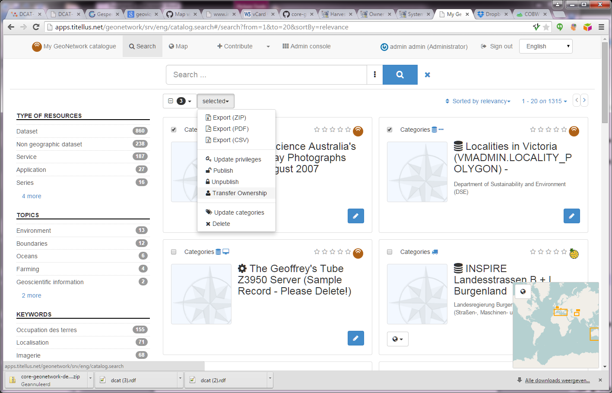
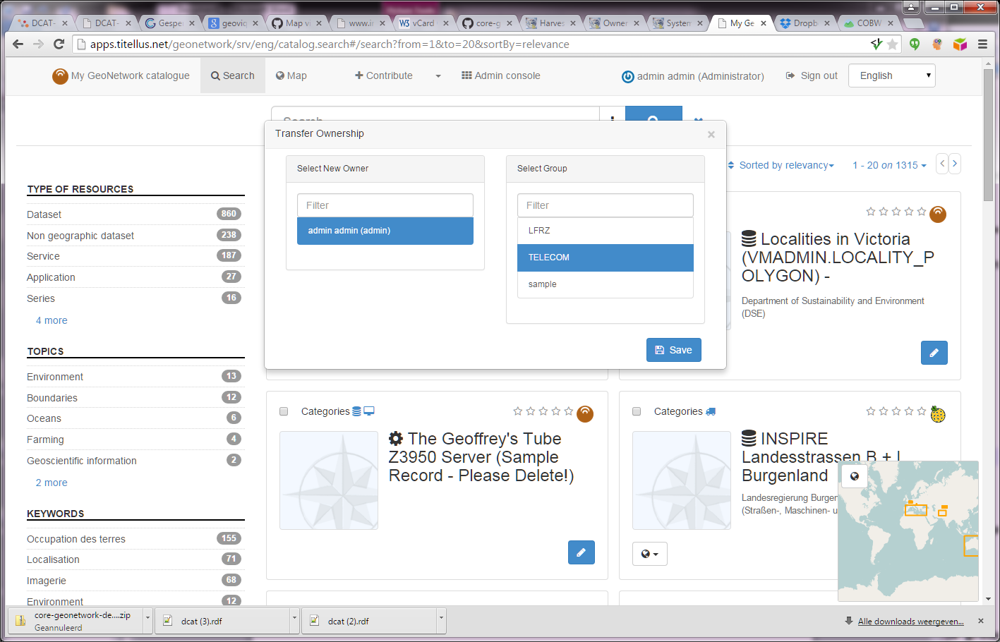

# Transferring privileges

## Transfer Ownership

When you need to transfer metadata ownership from one user to another for all or specific metadata records, use the *Transfer Ownership* option.

How to open the Transfer Ownership page

-   For several records, use "actions on selected set" in the search or the editor board.
-   For one record, use **Manage record** > **Transfer ownership** on the record page.

1.  The Portal displays the following panel.

    

    The Transfer Ownership panel

    -  **Select New Owner**: Select a user in this auto-complete.

    !!! note

        The drop down only lists the users you can transfer records to. See [Who can transfer ownership](#who-can-transfer-ownership).

    -   **Select group**: Select one of the groups this user is a member of. Privileges to groups All and Intranet are not transferable.

    !!! note

        Ownership of metadata records can only be transfered to [Workspace Groups](../../administrator-guide/managing-users-and-groups/creating-group.md#1-workspace-group). Other group types will not be shown in the list.

### Who can transfer ownership

What you can transfer depends on your profile. For Editors and Reviewers, the profile that counts is the one you have in each group, not your highest profile in the catalogue. "At least Editor" means Editor, Reviewer or User Administrator in that group.

| Profile | Records you can transfer | Groups you can transfer to | Users you can transfer to |
|---|---|---|---|
| Anonymous, Registered User | None | - | - |
| Editor | Records you own | Workspace groups where you are at least Editor | Users who are at least Editor in the selected group |
| Reviewer | Records you own, and records in the groups where you are Reviewer | Workspace groups where you are at least Editor | Users who are at least Editor in the selected group |
| User Administrator | Records you can edit | Any workspace group | Members of your groups, or an Administrator |
| Administrator | All records | Any workspace group | Any user, or an Administrator |

!!! note

    Editors and Reviewers can't transfer a record to an Administrator without a group. Only User Administrators and Administrators can do this, and the record then keeps its current group.

If a record can't be transferred, it is skipped and reported at the end of the transfer. The other selected records are still transferred.

#### Examples

The catalogue has two workspace groups, *Hydrology* and *Soils*, with these users:

| User | Hydrology | Soils |
|---|---|---|
| Ana | Editor | - |
| Ben | Editor | - |
| Carla | Registered User | Editor |
| Dan | Reviewer | Editor |

-   **Ana transfers her record to Ben in Hydrology.** Allowed: Ana owns the record, and both are Editors in Hydrology.
-   **Ana transfers her record to Carla in Hydrology.** Not allowed: Carla is only a Registered User in Hydrology, so she couldn't edit the record.
-   **Ana transfers her record to Carla in Soils.** Not allowed: Ana isn't a member of Soils.
-   **Ana transfers a record owned by Ben.** Not allowed: Editors can only transfer records they own.
-   **Dan transfers a Hydrology record owned by Ben to Ana.** Allowed: Dan is Reviewer in Hydrology, so he can transfer any record in that group.
-   **Dan moves a Hydrology record to Carla in Soils.** Allowed: Dan reviews Hydrology, and both Dan and Carla are Editors in Soils.
-   **Dan transfers his own record in Soils to Carla.** Allowed: Dan owns the record. He is only Editor in Soils, but owners can always transfer their own records.
-   **Dan transfers a Soils record owned by Carla.** Not allowed: Dan is only Editor in Soils, not Reviewer, and he doesn't own the record.
